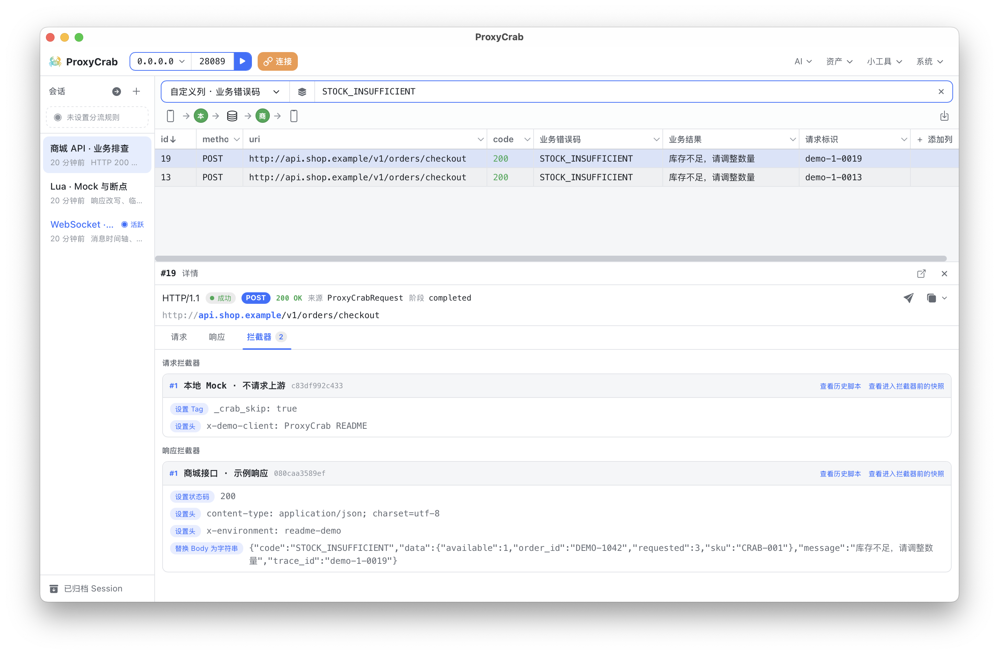
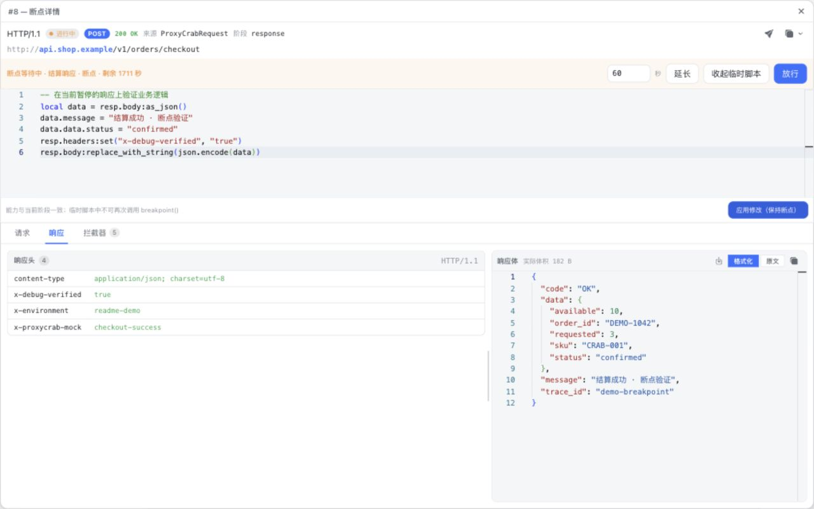
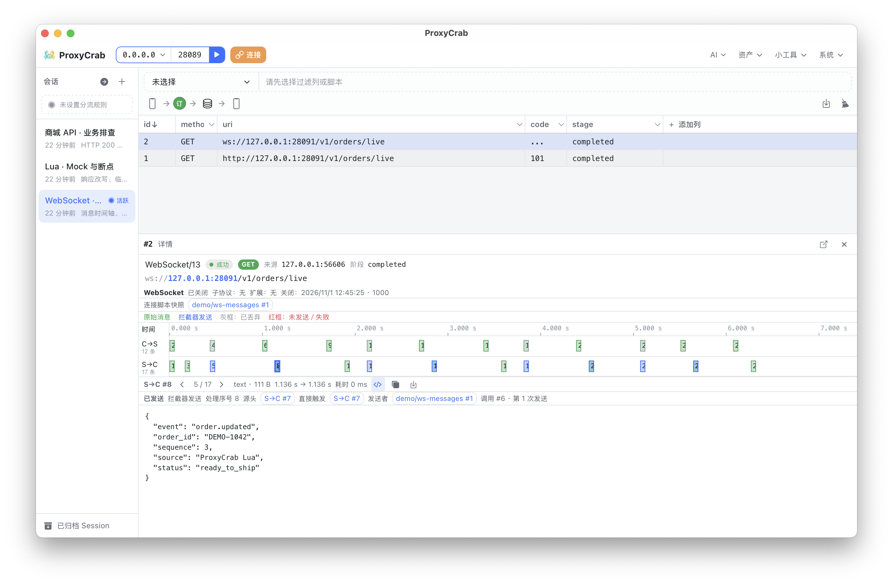
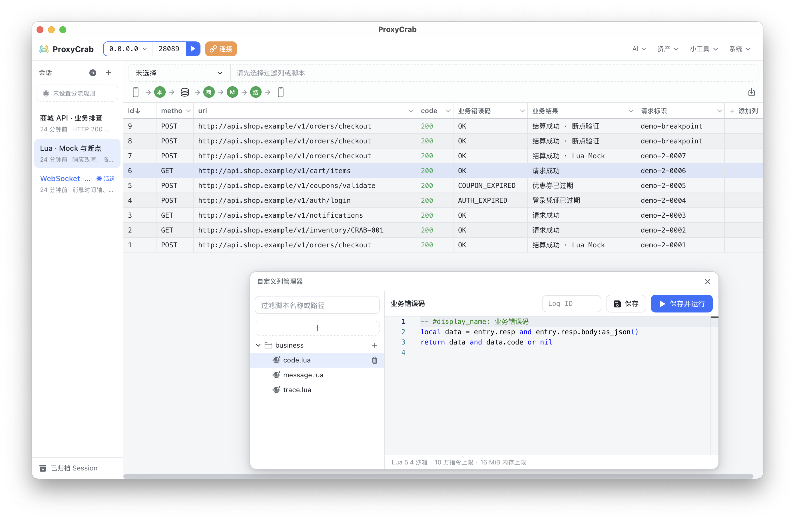

# ProxyCrab

English | [简体中文](README.md)

An HTTP/HTTPS capture and debugging tool built for collaboration with Agents.

Shape requests and responses with Lua, inspect bidirectional WebSocket messages, and share Sessions with teammates or Agents. Works as a desktop app, or as a CLI you run on a remote box and manage from a browser.



> The screenshot above comes from the browser management UI of a live CLI run, using a dedicated demo workspace and locally generated sample traffic.

## Core Capabilities

### Debug real traffic together with Agents

ProxyCrab exposes a management HTTP API plus a companion Skill, so Agents can read captured traffic directly, configure debugging rules, and sync their actions back into the UI.

You can ask an Agent to:

- Find failed requests and analyze the cause from request and response bodies.
- Wait for the next request matching a condition and check whether the issue reappears.
- Extract business fields and create custom columns and filters.
- Write Lua interceptors to mock APIs or adjust requests.
- Read a Session share link and help investigate specific traffic.

For example:

> Check the failed login requests in this session, add the business error code from the response as a column, and explain the failure reasons.

The workspace supports AGENTS.md behavior presets — you can allow read-only access to existing data, or let Agents adjust debugging settings. The management API offers per-action permissions, and the desktop app adds human approval on top.

Agent capabilities are provided by external Agents working with the ProxyCrab Skill.

### Control requests and responses with Lua

Each Session organizes its own request and response interceptor chains, executed in order, with scripts you can start, stop and rearrange.

- **Modify traffic**: rewrite URL, method, headers, response status codes and bodies.
- **Mock APIs**: skip the upstream request and respond with text or workspace assets.
- **Test network behavior**: throttle request and response body transfer speeds, set idle timeouts for upstream requests and response streams.
- **Breakpoint debugging**: pause a request, run ad-hoc Lua against the current state, then continue processing.
- **Trace executions**: inspect the historically executed source, modification records, and entry snapshots.

For example, rewriting JSON in a response interceptor:

```lua
local data = resp.body:as_json()
if data then
    data.message = "Hello from ProxyCrab"
    resp.body:replace_with_string(json.encode(data))
end
```

If a script changes later, the captured records still show the version that actually ran.



See [Lua API](docs/lua-api.md) for details.

### Share the debugging scene, reuse debugging configs

Create a read-only link for a Session so recipients can browse the traffic in a plain browser — no ProxyCrab installation needed.

The share page supports:

- Live updates for new requests and completion status.
- Independent filtering, sorting and detail views.
- Deep links that focus a specific request.
- WebSocket messages, historical interceptor results and snapshots.
- Body downloads and HAR export.

Links can be ephemeral or persisted across restarts; they expire immediately once sharing is disabled. Share links can be configured with read-time redaction policies that hide or replace sensitive fields within supported read scopes, while the raw capture stays intact.

To reuse debugging configs, enable **Session config download** to bundle related interceptors, filters, custom columns and selected assets. Recipients drag in the ZIP, pick the Sessions to import, and resolve file conflicts.

Config bundles contain no capture history; assets used by scripts must be selected by the sharer.

See [Session config sharing and import](docs/session-config-bundles.md) for details.

## More Ways to Debug

### Bidirectional WebSocket message debugging

Inspect client and server messages on a bidirectional timeline, view text or binary content, and track connection state.

Through Lua message callbacks you can:

- Drop specific messages.
- Send messages to the client or the server.
- Combine drop and send to replace messages.
- Read already-processed history messages.
- Inspect generation origins, trigger relations, and send or drop results.

For example, registering a callback in a request interceptor to intercept the client's `ping` and reply with `pong` directly:

```lua
req:on_ws_message(function(ws)
    local message = ws.message
    if message.direction == "request"
        and message.type == "text"
        and message.body == "ping" then
        ws:drop()
        ws:send("response", "pong", "text")
    end
end)
```

Currently, WebSocket connections established via HTTP/1.1 Upgrade are supported.



### Put business fields into the capture list

Beyond built-in columns like method, URL and status code, you can extract business fields from requests and responses with Lua to create custom columns and filters.

For example, surfacing the business error code from responses as a column:

```lua
local data = entry.resp and entry.resp.body:as_json()
return data and data.code or nil
```

Handy for cases like "HTTP 200, but the business operation failed" — also works for order IDs, request identifiers or business states.

Each Session keeps its own column config and filter conditions.



### Desktop app and remote browser management

Run the desktop app locally, or start the CLI on a remote debug box and manage the proxy from a browser.

Both modes share the same proxy core and main debugging UI. The CLI embeds the browser management page, so no extra frontend service is required.

| Mode | Current build targets |
| --- | --- |
| Desktop app | macOS ARM64 (DMG), Linux x64 (AppImage), Windows x64 (EXE / MSI) |
| CLI | Linux x64 / ARM64, macOS ARM64, Windows x64 |

Some host capabilities differ: the desktop app provides human approval and Skill path management; the CLI offers allow/deny permission config and installs Skills via a local command.

### Other capabilities

| Feature | Purpose |
| --- | --- |
| Request editing & replay | Modify and resend requests through the selected Session's interceptor chain |
| CA download & Clash subscription | Configure device access via certificate download, subscription link and QR code |
| Session archiving & restore | Save and organize captures by issue or debugging stage |
| Lua routing rules | Decide whether traffic enters the active Session or is forwarded directly |
| Body viewing & download | Inspect text, images and Protobuf/gRPC structures; download fully decoded content |
| HAR export | Export the HTTP records in the current filter result |
| Workspace assets | Manage reusable files for mocks, body replacement and request replay |
| Debugging tools | Base64 encode/decode, JWT decode & verify, QR codes, text diff |

## Quick Start

### Desktop app

1. Launch ProxyCrab, create a Session and make it active.
2. Open **Certificate setup** under **Connect**, download the CA; to capture HTTPS, install and trust it on the device being debugged.
3. Point the device or app's HTTP/HTTPS proxy at the machine running ProxyCrab — the default proxy port is `8089`.
4. Start the proxy in ProxyCrab.
5. Send requests and watch them appear in the Session.

When connecting through Clash, pick the local IP on the **Proxy connection** page, then enable and import the subscription.

The proxy stays stopped by default when the desktop app launches. Without an active Session, traffic is forwarded directly; once a routing script is selected, the script decides whether to capture.

### CLI with browser management

```bash
proxycrab-cli run --workspace /path/to/workspace
```

The CLI starts the proxy and prints the browser management URL along with an Access Token. Open the URL, enter the token, and you're in the management UI.

Default ports:

| Service | Port |
| --- | --- |
| HTTP/HTTPS proxy | `8089` |
| Management UI & HTTP API | `18089` |

Listening config can be overridden via launch arguments:

```bash
proxycrab-cli run \
  --workspace /path/to/workspace \
  --proxy-port 8089 \
  --api-port 18089
```

For remote access, use SSH port forwarding, or a reverse proxy with authentication and TLS. The default HTTP connection is unencrypted and should stay on a trusted network.

### Configure the Agent Skill

On desktop, open **AI → Manage Skills**, configure the Skill parent directory your Agents use, and sync.

CLI users can run:

```bash
proxycrab-cli install-skill --parent ~/.agents/skills
```

Then let an Agent that supports the Skill read the ProxyCrab workspace, or hand it a Session share link for investigation.

See [ProxyCrab Skill](skills/proxycrab/SKILL.md) for details.

## Notes

- HTTPS decryption requires the debugged client to trust the ProxyCrab CA; clients using certificate pinning may not be capturable directly.
- Read-time redaction requires a configured script and only affects supported read scopes; raw captures and forwarded traffic remain unchanged.
- HTTP bodies are streamed by default; Lua body-reading calls wait for the complete content and are not suited to unbounded streams.
- HAR export covers HTTP records and does not include WebSocket message history.
- Session sharing requires the service to keep running and the recipient to reach the share URL.

## Documentation

- [Management API, permissions & Session sharing](docs/backend-api.md)
- [Lua API & examples](docs/lua-api.md)
- [Session config sharing & import](docs/session-config-bundles.md)
- [Agent Skill & workflows](skills/proxycrab/SKILL.md)
- [Agent debugging practices](skills/proxycrab/references/best-practices.md)
- [Runtime & development details](docs/runtime-notes.md)

Note: the linked docs are currently in Chinese.

## Development

The project uses Rust, Tauri and Vue. The desktop app and the CLI share the proxy core, management API and frontend code.

| Directory | Contents |
| --- | --- |
| `crates/proxy-crab-mitm` | Proxy, TLS, capture storage and Lua execution |
| `crates/proxy-crab-mgr` | Management API, permission contracts and sharing service |
| `src-tauri` | Desktop app integration |
| `cli-app` | CLI and embedded browser management service |
| `src` | Vue management UI and Session share pages |
| `skills/proxycrab` | Agent Skill, scripts and reference docs |

Install frontend dependencies:

```bash
pnpm install
```

Start the desktop dev environment:

```bash
pnpm tauri dev
```

To build the CLI, first generate the frontend assets to embed:

```bash
pnpm build
cargo build --release -p proxycrab-cli
```

Checks and tests:

```bash
cargo check --workspace
cargo test --workspace
cargo clippy --workspace --all-targets -- -D warnings
pnpm test:unit
pnpm build
```

The WebKit-based dev setup for the Linux AppImage and other implementation details are covered in [runtime & development details](docs/runtime-notes.md).

### CI builds & releases

Pushing a `build/*` branch or manually running the `Build Artifacts` workflow builds every Desktop and CLI target listed above and uploads CI artifacts.

When a branch starting with `build/v` is pushed, a formal Release is published automatically after all builds succeed — for example, `build/v1.2.0` maps to tag and title `v1.2.0`. Pushing the same branch again updates that Release's assets and moves the tag to the new build commit. Manually running the workflow does not publish a Release.

Release assets provide the Linux AppImage, macOS DMG, Windows EXE / MSI installers directly, plus CLI archives for the four platforms.

## Support the Author

ProxyCrab is open source under the MIT license and completely free to use. If you find it useful, consider supporting the author via [these channels](docs/support.md).

## Links

[Linux.do](https://www.linux.do)
