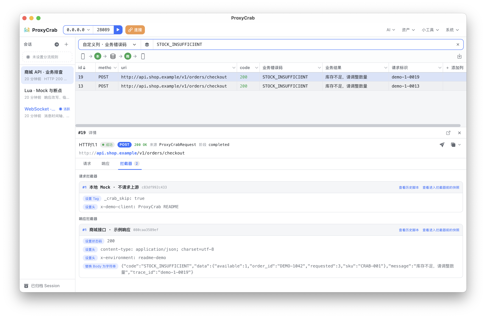
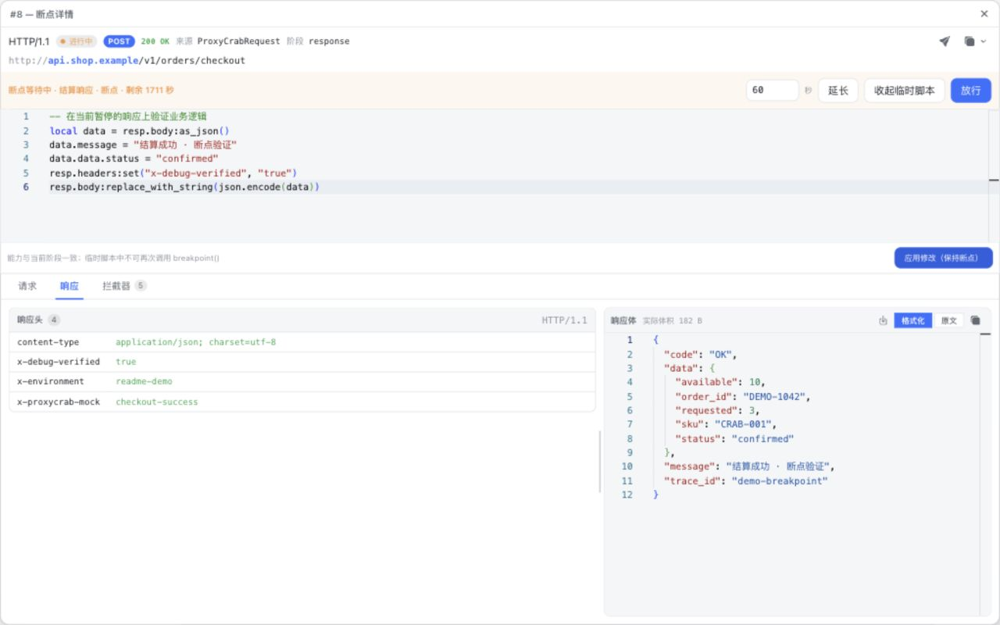
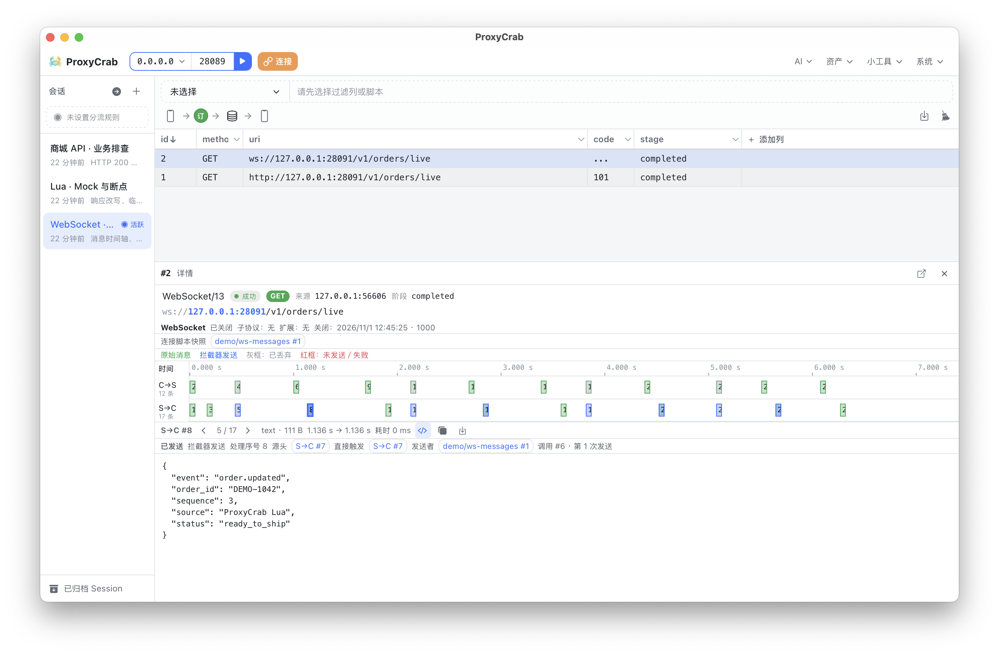
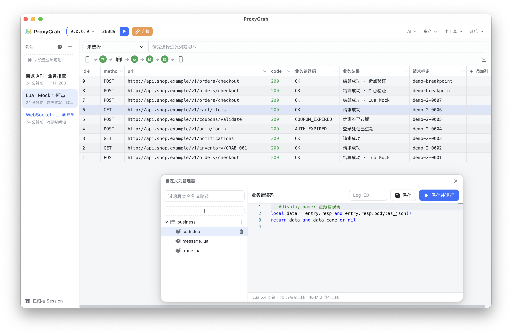

# ProxyCrab

支持 Agent 协作的 HTTP/HTTPS 抓包与调试工具。

通过 Lua 定制请求与响应，检查 WebSocket 双向消息，把 Session 分享给同事或 Agent。支持桌面应用，也支持通过 CLI 运行并在浏览器中管理。



> 本页截图来自实际运行的 CLI 浏览器管理界面，使用独立演示工作区和本机生成的示例流量。

## 核心能力

### 与 Agent 一起调试真实流量

ProxyCrab 提供管理 HTTP API 和配套 Skill，让 Agent 直接读取抓包数据、配置调试规则，并将操作结果同步到界面。

你可以让 Agent：

- 找出失败请求，结合请求和响应内容分析原因。
- 等待下一条符合条件的请求，检查问题是否再次出现。
- 提取业务字段，创建自定义列与过滤条件。
- 编写 Lua 拦截器，配置接口 Mock 或调整请求。
- 读取 Session 分享链接，根据指定流量协助排查。

例如：

> 检查这个 Session 中登录失败的请求，将响应里的业务错误码添加为一列，并说明失败原因。

工作区支持 AGENTS.md 行为预设，可选择只读取现有数据，或允许 Agent 调整调试配置。管理 API 提供按操作配置的权限，桌面端还支持人工审批。

Agent 能力由外部 Agent 配合 ProxyCrab Skill 提供。

### 用 Lua 控制请求与响应

为每个 Session 组织独立的请求、响应拦截器链，按顺序执行、启停和调整脚本。

- **修改流量**：调整 URL、请求方法、请求头、响应状态码和 Body。
- **构造 Mock**：跳过上游请求，使用文本或工作区资源返回响应。
- **测试网络行为**：限制请求与响应 Body 的传输速度，设置上游请求和响应流空闲超时。
- **断点调试**：暂停请求，在当前状态上执行临时 Lua，再继续处理。
- **追溯执行过程**：查看历史执行源码、修改记录和执行入口快照。

例如，在响应拦截器中修改 JSON：

```lua
local data = resp.body:as_json()
if data then
    data.message = "Hello from ProxyCrab"
    resp.body:replace_with_string(json.encode(data))
end
```

脚本后续发生变化，也可以通过抓包记录查看当时实际执行的版本。



详见 [Lua API](docs/lua-api.md)。

### 分享调试现场，复用调试配置

为 Session 创建只读链接，让接收者直接通过浏览器查看流量，无需安装 ProxyCrab。

分享页面支持：

- 持续查看新请求和请求完成状态。
- 独立筛选、排序和查看详情。
- 通过链接直接定位指定请求。
- 查看 WebSocket 消息、历史拦截结果和快照。
- 下载 Body、导出 HAR。

链接可以临时使用，也可以设置为重启后保留；关闭分享后立即失效。可为分享链接配置读取时脱敏策略，在支持的读取范围内隐藏或替换敏感字段，同时保留原始抓包数据。

需要复用调试配置时，还可以开放 **Session 配置下载**，打包相关拦截器、过滤器、自定义列和选定资源。接收者拖入 ZIP，选择要导入的 Session，并处理文件冲突。

配置包不包含抓包历史，脚本使用的资源需要由分享者选择。

详见 [Session 配置分享与导入](docs/session-config-bundles.md)。

## 更多调试方式

### WebSocket 双向消息调试

在双向时间轴中检查客户端与服务端消息，查看文本或二进制内容，并追踪连接状态。

通过 Lua 消息回调，可以：

- 丢弃指定消息。
- 向客户端或服务端发送消息。
- 组合丢弃与发送，实现消息替换。
- 读取已处理的历史消息。
- 查看生成来源、触发关系以及发送或丢弃结果。

例如，在请求拦截器中注册回调，拦截客户端的 `ping` 并直接回复 `pong`：

```lua
req:on_ws_message(function(ws)
    local message = ws.message
    if message.direction == "request"
        and message.type == "text"
        and message.body == "ping" then
        ws:drop()
        ws:send("response", "pong", "text")
    end
end)
```

当前支持通过 HTTP/1.1 Upgrade 建立的 WebSocket 连接。



### 把业务字段放进抓包列表

除了方法、URL、状态码等内置列，还可以通过 Lua 从请求和响应中提取业务字段，创建自定义列与过滤条件。

例如，将响应中的业务错误码显示为一列：

```lua
local data = entry.resp and entry.resp.body:as_json()
return data and data.code or nil
```

适合检查“HTTP 状态码为 200，但业务处理失败”等情况，也可以用于展示订单号、请求标识或业务状态。

每个 Session 保存自己的列配置和过滤条件。



### 桌面操作与远程浏览器管理

在本机使用桌面应用，或在远程调试机上启动 CLI，通过浏览器管理代理。

两种运行方式共享代理核心和主要调试界面。CLI 内嵌浏览器管理页面，不需要另外部署前端服务。

| 运行方式 | 当前构建目标 |
| --- | --- |
| 桌面应用 | macOS ARM64（DMG）、Linux x64（AppImage）、Windows x64（EXE / MSI） |
| CLI | Linux x64 / ARM64、macOS ARM64、Windows x64 |

部分宿主能力有所区别：桌面端提供人工审批和 Skill 路径管理；CLI 提供允许/拒绝权限配置，并通过本地命令安装 Skill。

### 其他能力

| 功能 | 用途 |
| --- | --- |
| 请求编辑与重放 | 修改并重新发送请求，经过所选 Session 的拦截器链 |
| CA 下载与 Clash 订阅 | 通过证书下载、订阅链接和二维码配置设备接入 |
| Session 归档与恢复 | 按问题或调试阶段保存、整理抓包记录 |
| Lua 分流规则 | 决定流量进入当前活跃 Session，或直接转发 |
| Body 查看与下载 | 查看文本、图片及 Protobuf/gRPC 数据结构，下载完整解码内容 |
| HAR 导出 | 导出当前筛选结果中的 HTTP 请求记录 |
| 工作区资源 | 为 Mock、Body 替换和请求重放管理可复用文件 |
| 调试小工具 | Base64 编解码、JWT 解码与验签、二维码、文本比对 |

## 快速开始

### 桌面应用

1. 启动 ProxyCrab，创建一个 Session 并将其设为活跃。
2. 打开“连接”中的“证书配置”，下载 CA；需要抓取 HTTPS 时，在被调试设备上安装并信任它。
3. 将设备或应用的 HTTP/HTTPS 代理指向 ProxyCrab 所在机器，默认代理端口为 `8089`。
4. 在 ProxyCrab 中启动代理。
5. 发起请求，在 Session 中查看捕获结果。

使用 Clash 接入时，可以在“代理连接”页面选择本机 IP，开启并导入订阅。

桌面应用启动时代理默认停止。没有活跃 Session 时，流量直接转发；选择分流脚本后，由脚本决定是否捕获。

### CLI 与浏览器管理

```bash
proxycrab-cli run --workspace /path/to/workspace
```

CLI 启动后运行代理，并输出浏览器管理地址和 Access Token。打开地址，输入 Token，即可进入管理界面。

默认端口：

| 服务 | 端口 |
| --- | --- |
| HTTP/HTTPS 代理 | `8089` |
| 管理界面与 HTTP API | `18089` |

可通过启动参数覆盖监听配置：

```bash
proxycrab-cli run \
  --workspace /path/to/workspace \
  --proxy-port 8089 \
  --api-port 18089
```

远程访问可使用 SSH 端口转发，或通过配置了认证和 TLS 的反向代理访问。默认 HTTP 连接不加密，应在可信网络中使用。

### 配置 Agent Skill

桌面端打开 **AI → 管理 Skill**，配置 Agent 使用的 Skill 父目录并同步。

CLI 用户可以运行：

```bash
proxycrab-cli install-skill --parent ~/.agents/skills
```

随后让支持该 Skill 的 Agent 读取 ProxyCrab 工作区，或提供 Session 分享链接进行排查。

详见 [ProxyCrab Skill](skills/proxycrab/SKILL.md)。

## 使用说明

- HTTPS 解密需要被调试客户端信任 ProxyCrab CA；使用证书固定的客户端可能无法直接捕获。
- 读取时脱敏需要配置脚本，仅作用于支持的数据读取范围；原始抓包与转发内容保持不变。
- HTTP Body 默认流式处理；Lua 调用 Body 读取方法时，需要等待完整内容，不适合直接读取无限流。
- HAR 导出保留 HTTP 记录，不包含 WebSocket 消息历史。
- Session 分享需要服务保持运行，并且接收者能够访问分享地址。

## 文档

- [管理 API、权限与 Session 分享](docs/backend-api.md)
- [Lua API 与示例](docs/lua-api.md)
- [Session 配置分享与导入](docs/session-config-bundles.md)
- [Agent Skill 与操作流程](skills/proxycrab/SKILL.md)
- [Agent 排查实践](skills/proxycrab/references/best-practices.md)
- [运行与开发细节](docs/runtime-notes.md)

## 开发

项目使用 Rust、Tauri 和 Vue。桌面应用与 CLI 复用代理核心、管理接口和前端代码。

| 目录 | 内容 |
| --- | --- |
| `crates/proxy-crab-mitm` | 代理、TLS、抓包存储与 Lua 执行 |
| `crates/proxy-crab-mgr` | 管理接口、权限契约与分享服务 |
| `src-tauri` | 桌面应用集成 |
| `cli-app` | CLI 与内嵌浏览器管理服务 |
| `src` | Vue 管理界面与 Session 分享页面 |
| `skills/proxycrab` | Agent Skill、脚本与参考文档 |

安装前端依赖：

```bash
pnpm install
```

启动桌面开发环境：

```bash
pnpm tauri dev
```

构建 CLI 时，先生成需要嵌入的前端资源：

```bash
pnpm build
cargo build --release -p proxycrab-cli
```

检查与测试：

```bash
cargo check --workspace
cargo test --workspace
cargo clippy --workspace --all-targets -- -D warnings
pnpm test:unit
pnpm build
```

Linux AppImage 的 WebKit 开发方式及其他实现细节见[运行与开发细节](docs/runtime-notes.md)。

### CI 构建与 Release

推送 `build/*` 分支或手动运行 `Build Artifacts` 工作流，会构建上表中的全部 Desktop 和 CLI 目标，并上传 CI 产物。

推送以 `build/v` 开头的分支时，全部构建成功后自动发布正式 Release。例如，`build/v1.2.0` 对应标签和标题 `v1.2.0`。再次推送同一分支会更新该 Release 的附件，并将标签移至本次构建的提交。手动运行工作流不发布 Release。

Release 附件直接提供 Linux AppImage、macOS DMG、Windows EXE / MSI 安装包，以及四个平台的 CLI 压缩包。
